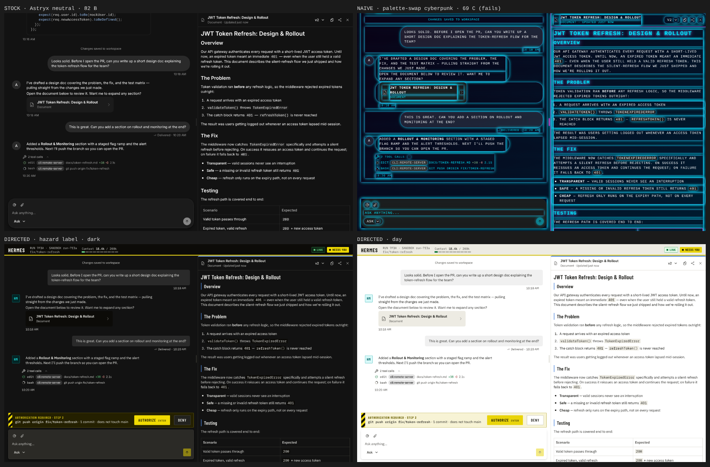

# B6 · Cyberpunk agent console



| Variant | Score | Gate | Slop tells | Expression |
|---|---|---|---|---|
| stock: Astryx `ai-chat`, neutral | 82 B | PASS | 0 | 35 |
| naive: cyan/magenta, glow, uppercase mono, scanlines | 69 C | FAIL | 4 | 40 (capped) |
| directed: "Hazard label", `netrunner` theme (dark) | 88 A | PASS | 0 | 55 |
| directed: `netrunner-day` | 88 A | PASS | 0 | 55 |

Direction: [DIRECTION.md](DIRECTION.md). Stat sheets and screenshots: `runs/`
(`runs/directed/states-desktop.png` and `states-mobile.png` show all six states).

## Run it

```bash
cd benchmarks/B6-cyberpunk/app
npm ci && node gen-theme.mjs && npx vite build
npx serve dist            # or: python3 -m http.server -d dist 8822
# ?variant=stock|naive|directed  &mode=dark|light  &state=attention|running|done|error|empty|loading
omni check "http://localhost:8822/index.html?variant=directed" --states attention,running,done,error,empty,loading
```

`dist/` is committed, so you can serve it without building.

## What this benchmark taught the toolkit

- **The naive control first scored 84, same as directed.** Expression rewarded
  any color, including neon glow. Fixed: with 2+ slop tells Expression is capped
  at 40, and 3+ tells cap the overall at C.
- **Three more checker false positives on Astryx**, fixed: a text field alone in
  a composer card (WCAG 2.5.8 spacing exception), focus shown on a wrapper via
  `:focus-within`, and the caret as a focus indicator.
- **The theme engine caught a lookalike** (info ≈ active) in the first netrunner
  preset before any page was built.
- **Bright signage accents** (yellow fill, black legend in both modes) needed a
  new preset option, `accent.bright`.

## What's built, and what isn't

Built on Astryx components: transcript, tool calls, artifact panel (stock), plus
our pieces: deck plate with lamps and context meter, authorization bar (the only
hazard tape), stop, empty / loading / error states, agent plate, theme via the
bridge (zero raw colors in the app CSS).

Not built: live streaming with stick-to-bottom, Ctrl+K palette, sound, an
Effects Full/Subtle/Off dial (there are no effects to turn off yet). Dark-mode
red and cyan fills are pastel because the engine keeps dark legends on them.
Expression is 55: more restrained than "flex-worthy" may want. David's verdict decides.
