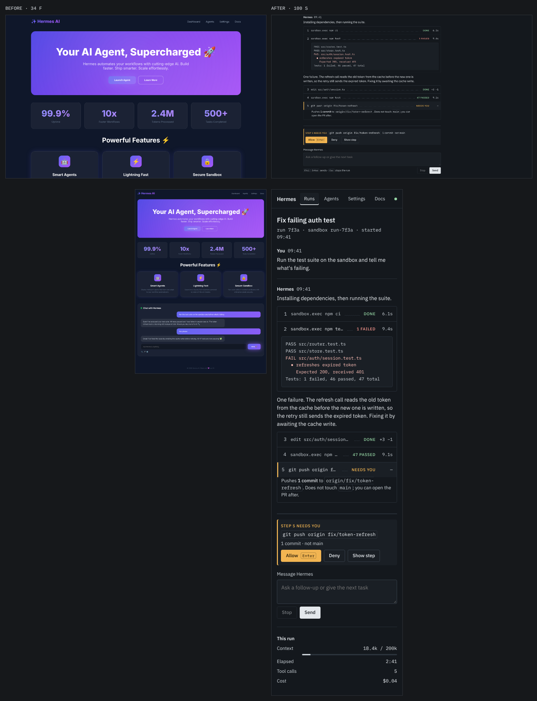

# Walkthrough: fixing a vibe-coded page with UI-MAX

`before.html` is what a one-shot prompt like "make a modern AI agent dashboard
for Hermes" typically produces. `after.html` is the same product fixed with the
UI-MAX loop. Every step below is a real command; the outputs are in this folder.

```
before 34 F  ──────────────▶  after 100 S
gate FAIL                      gate PASS
9 slop tells                   0
13 a11y issues                 0
```



## 1. Check + plan (the tool finds what's wrong)

```bash
omni plan examples/fix-vibecoded/before.html --task "Hermes agent chat with tool calls" --out before-check
# ✘ FAIL  34 (F)  fixes: P0 9 · P1 17 · P2 9
```

`before-check/FIXPLAN.md` sorts 35 fixes:

- **P0, blocks use:** 810px of horizontal scroll at 390px (fixed 1200px container), an unlabeled input, invisible keyboard focus, tap targets 17–20px tall, footer contrast 2.36:1.
- **P1, why it reads as vibe coded:** tech gradient, default indigo/violet accent, feature-tile grid, glass blur everywhere, monument stats ("10x", "99.9%"), centered stack, default type (Inter), glow on everything, emoji icons. Missing states: focus, active, disabled, loading, empty, error. Three infinite animations and no reduced-motion handling.
- **P2, craft:** 12 text elements below APCA contrast, 11 font sizes, `transition: all`, no tabular numbers.
- **Use-case must-haves:** routed to the `agent-chat` playbook, which adds step cards, an approval prompt that can't scroll away, Esc to stop, a context meter, and so on.

With more than two P1 tells, the plan says patching won't work: recompose.

## 2. Direction (a person/agent decides, the tool can't)

`DIRECTION.md`: surface **Operate**; concept **"a run is an electronic
checklist"** (Boeing ECL lines `ITEM ....... STATE`, Airbus ECAM colour code:
green done, amber needs you, red failed). IBM Plex for type, vendored under
`fonts/` (OFL). Ornament budget: the approval line, the running indicator, the
leader dots. Refused: hero, stat tiles, feature cards, gradients, glass, emoji,
chat bubbles.

What was kept from the before page: the real content (the test-suite
conversation, the 401 in `session.test.ts`, the cache-write fix) and the nav.
The vanity stats became facts that drive decisions: context used, elapsed,
tool calls, cost.

## 3. Build, check, look, fix (four rounds)

| Round | Score | What the check or the screenshots showed | Fix |
|---|---|---|---|
| 1 | 94 A, PASS | APCA: red/green/amber status text Lc 40–59 on the dark panel | Lightened status colours (`DIRECTION.md` notes why) |
| 2 | 97 S | Output text and 14px secondary sentences just under Lc 75 | Raised the secondary text token, not individual elements |
| 3 | 98 S | **Looking at the screenshot:** the approval (step 5) sat below the fold, behind the composer. The score can't see this; the playbook's task #2 fails | Pinned the decision above the composer |
| 4 | 98 S | **Looking at the six forced states:** the empty state showed run facts for a run that doesn't exist; on mobile the facts rail pushed the work down | Hid the run head and facts when empty; moved the rail below on narrow screens |

Then a tool fix, not a page fix: the line-length probe counted a checklist `<li>`
wrapping a code block as a paragraph (false "lines too long"). Fixed in
`src/check.js`; responsive went 85 → 100.

States are forced with `?state=` and screenshotted as contact sheets:
`after-check/states-desktop.png`, `after-check/states-mobile.png`
(attention, running, empty, loading, error, done).

## 4. Prove it

```bash
omni diff examples/fix-vibecoded/before.html examples/fix-vibecoded/after.html --out diff
npm test   # test/fix-example.test.js: before must fail for these reasons, after must pass in every state
```

## What the score does not cover (honest gaps)

100 S means nothing the tool can measure is wrong. It does not mean finished:

- From the playbook, not built in this static scenario: Ctrl/Cmd+K palette, live
  streaming with stick-to-bottom and a "New output" pill, per-message cost on hover.
- The content is a scripted scenario derived from the before page, not a live Hermes session.
- David's verdict is the number that matters. Log it with
  `omni verdict examples/fix-vibecoded/after.html keep|reject "<why>" --property <what> --check examples/fix-vibecoded/after-check`.

## Through the MCP tools (what an agent does)

`ui_fix_plan(target, task)` → read the plan → `ui_playbook("agent-chat")` →
write DIRECTION.md → build → `ui_check(target, states)` → read STATS.md and
**look at the screenshots** → fix → `ui_diff(before, after)` → ask the user →
`ui_verdict(...)`.

---

# Round 2: David's verdict and two v2 variants

**Verdict on v1 (`after.html`, scored 100 S at the time):** "somewhat of a
improvement but it lacks color and enough structure and the buttons and
settings are vibecoded… right track… not good enough to flex."

What changed in the toolkit because of it:

- Logged with `omni verdict` (evidence: gate agreed with David 1/2), and as new
  Never/Always rules in `skills/ui-max/references/taste.md`.
- New **Expression** stat (`src/expression.js`): Hasler–Süsstrunk colorfulness,
  color share, hue families, framed regions. S now requires expression ≥ 70.
  v1 re-scores **87 B** (expression 35: colorfulness 11, 0.5% color), which
  matches the verdict. Tests encode this so it can't silently regress.
- Known gap: "framed regions" didn't flag v1's thin structure (it counted 10).
  Structure still needs eyes.

Then two concepts built in parallel (research: parallel prototypes beat serial polish):

| | v2-A Flight deck | v2-B Vision mixer |
|---|---|---|
| Concept | Hermes flies, you're the captain: glass-cockpit display units, ECAM color code, synoptic run path, master caution | Hermes stages actions on PREVIEW, you TAKE them to PROGRAM: multiviewer, tally colors, source bus |
| Controls | Backlit annunciator keys; lit = solid fill; master caution lights when you're needed | Illuminated bus keys, a big TAKE key, CUT (deny), FTB (stop) |
| Score | 95 S, expression 75 | 100 S, expression 100 |
| Strength | Calm, legible, the color code is a real standard | Most impressive at a glance; the decision is the biggest thing on screen |
| Weakness | Comms panel has dead space; color still mostly line-weight | Red means both "on air" and "failed"; Take/Cut/FTB jargon costs learning; long runs scroll inside a monitor |
| Files | `v2-flightdeck/` | `v2-mixer/` |

Both: every state forced and looked at on desktop and 390px; empty/loading
show no invented run facts; the decision is reachable without scrolling on
phones. Neither has the Ctrl+K palette or live streaming yet.

Open each with `?state=attention|running|empty|loading|error|done`.

---

# Round 3: managed themes, grounded color, use-case fit

**Verdict on v2:** "good upgrade but it needs better theme management and
colors and a little everywhere it just needs a little more grounding… it can
work but it depends on usecase."

Toolkit changes:

- **Theme engine** (`src/theme-engine.js`, `omni themegen`, MCP `ui_themegen`):
  a few OKLCH inputs per preset → every semantic role (surface ladder with inset
  wells, text 1–3, and grounded status families: fg / tinted bg / border /
  solid / on-solid). Lightness is solved until every pair passes APCA, lit
  legends also pass WCAG 2 AA, and no two status families may collapse into one
  color. 7 presets × 42 checks, all passing (`test/theme.test.js`).
- **The engine caught real bugs:** in `studio`, "on air" and "failed" were
  the same color (both hue 27); in `ledger`, info and selection were. Fixed in
  the presets, not patched in pages.
- **Sprinkled-color check:** `omni check` counts raw color literals in component
  CSS. Flight deck had 39, mixer 10. Both are now **0**.
- **Use case decides the concept:** each playbook has a "Concepts & themes"
  section; `omni route` / `ui_route` recommend presets. Agent chat: flight deck
  for long autonomous runs, vision mixer for high-stakes approvals and demos;
  tables/settings: ledger; monitoring: master control.

| Page | Theme | Score |
|---|---|---|
| v2-flightdeck | night / day / high contrast | 97 S / 95 S / 96 S |
| v2-mixer | studio / daylight | 100 S / 97 S |

Side by side: `v2-flightdeck/themes.png`, `v2-mixer/themes.png`. Switch live
with the theme keys on each page, or `?theme=<name>`.
