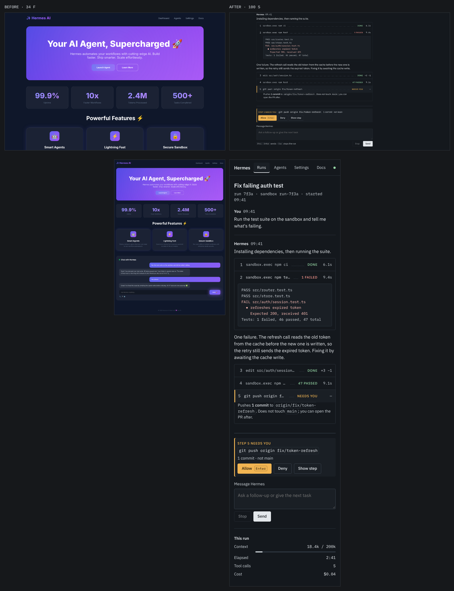

# omni diff

before: `before.html`  →  after: `after.html`

| stat | before | after | Δ |
|---|---:|---:|---:|
| access | 53 | 100 | +47 |
| originality | 0 | 100 | +100 |
| states | 25 | 100 | +75 |
| motion | 52 | 100 | +48 |
| responsive | 30 | 100 | +70 |
| craft | 55 | 100 | +45 |
| **overall** | **34 F** | **100 S** | **+66** |

Gate: FAIL → PASS

Slop tells removed: Tech gradient, Default accent hue, Feature-tile grid, Unearned blur, Monument stat, Center stack, Default type, Ornament everywhere, Emoji icons
A11y issues: 13 → 0

