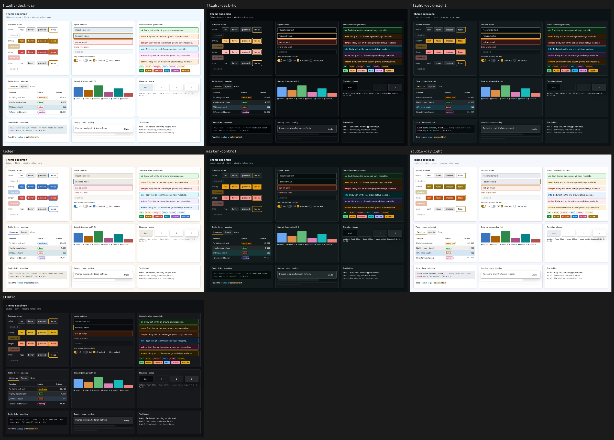

# Theme specimen report

| theme | missing roles | APCA fails | a11y |
|---|---|---|---|
| flight-deck-day | 0 | 0/107 | 100 |
| flight-deck-hc | 0 | 0/107 | 100 |
| flight-deck-night | 0 | 0/107 | 100 |
| ledger | 0 | 0/107 | 100 |
| master-control | 0 | 0/107 | 100 |
| studio-daylight | 0 | 0/107 | 100 |
| studio | 0 | 0/107 | 100 |

Forced colors (Windows High Contrast) on the first theme: `forced-colors.png`. Check focus rings, borders on controls, and that status is still readable without color.
